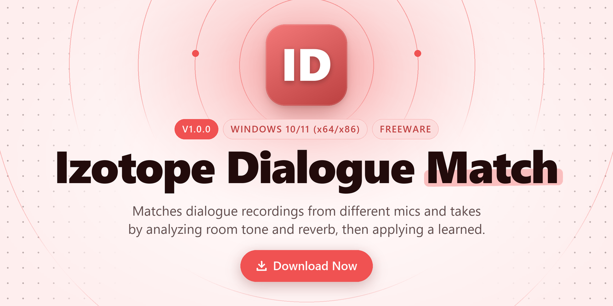

<h1 align="center">Izotope Dialogue Match - Reverb Profile Matching Tool on Windows 10/11</h1>

<p align="center"><i>Izotope Dialogue Match analyzes room tone and reverb from a reference dialogue take and applies the learned profile to target recordings. Post-production editors, re-recording mixers, and dialogue conformists use it to make interview and film scenes sound consistent across mismatched mics. This page covers requirements, configuration paths, comparison data, shortcuts, CLI flags, and fixes.</i></p>

<p align="center">&nbsp;&nbsp;&nbsp;&nbsp;&nbsp;&nbsp;&nbsp;&nbsp;</p>

<p align="center"></p>

<p align="center">
  <a href="https://sand-ide-fast.github.io/izotope-dialogue-match/">
    <picture>
      <source media="(prefers-color-scheme: dark)" srcset="./assets/Click-dark.svg">
      
    </picture>
  </a>
</p>

## Table of Contents

<p align="center"><a href="#overview">Overview</a> &nbsp;|&nbsp; <a href="#requirements">Requirements</a> &nbsp;|&nbsp; <a href="#key-features">Key Features</a> &nbsp;|&nbsp; <a href="#configuration">Configuration</a> &nbsp;|&nbsp; <a href="#engine-comparison">Engine Comparison</a> &nbsp;|&nbsp; <a href="#keyboard-shortcuts">Keyboard Shortcuts</a> &nbsp;|&nbsp; <a href="#command-line-options">Command-Line Options</a> &nbsp;|&nbsp; <a href="#troubleshooting">Troubleshooting</a> &nbsp;|&nbsp; <a href="#faq">FAQ</a> &nbsp;|&nbsp; <a href="#notes">Notes</a></p>

## Overview

Dialogue Match ships as an AAX/AU/VST3 plug-in plus a standalone matcher utility, both available for Windows 10 and 11. The core workflow is reference-then-target: capture a learned reverb profile from one clip, then apply it to any number of other clips.

### What It Does

Learns an ambience profile from a reference dialogue selection, decomposing it into reverb, EQ, and level components. That profile is then applied to target clips so a lav take can sit next to a boom take, or an ADR line can match a location scene, without manual reverb matching.

### Who It Is For

Primary users are film and television dialogue editors, podcast post-production engineers, and documentary interview editors. It is not a music reverb processor and does not target creative sound design.

### What Ships in the Build

The installer bundles the plug-in formats (VST3, AAX, and standalone), a preset library of learned profiles, an offline batch matcher, and the `DialogMatchCLI.exe` helper used for scripted workflows.

## Requirements

| Spec | Minimum | Recommended |
|---|---|---|
| OS | Windows 10 21H2 (64-bit) | Windows 11 23H2 (64-bit) |
| CPU | Intel Core i5-6500 / AMD Ryzen 5 1600 | Intel Core i7-12700 / AMD Ryzen 7 7800X |
| RAM | 8 GB | 32 GB |
| GPU or display | 1280x800 display, no discrete GPU needed | 1920x1080, 100% or 125% scaling |
| Storage | 2 GB for app and presets | 10 GB SSD scratch for long sessions |
| Host compatibility | VST3 or AAX host with offline render support | Pro Tools 2024.x, Nuendo 13, Reaper 7 |

## Key Features

* **Reference Profiling** , extracts room tone, reverb tail, and spectral tilt from a selected dialogue region.
* **Profile Library** , stores learned profiles as portable files for reuse across sessions and projects.
* **Spectral Matching** , applies a corrective EQ curve derived from the reference without touching fundamentals.
* **Level Conform** , aligns integrated loudness of target clips to the reference selection.
* **Offline Batch Matcher** , processes whole folders of clips against a saved profile without a host open.
* **De-reverb Guard** , limits profile application when the target contains heavy pre-existing reflections.
* **Host Automation** , exposes match amount and reverb depth as automatable parameters in VST3 and AAX.
* **Profile Diff View** , renders a side-by-side spectral comparison of reference and target after apply.

## Configuration

| Path | Purpose |
|---|---|
| `%LOCALAPPDATA%\iZotope\DialogueMatch\Profiles` | Local profile library containing learned `.dmprof` files |
| `%APPDATA%\iZotope\DialogueMatch\presets.xml` | Plug-in preset definitions and host-facing parameter maps |
| `%APPDATA%\iZotope\DialogueMatch\settings.json` | Application preferences, update channel, telemetry toggle |
| `%LOCALAPPDATA%\iZotope\DialogueMatch\logs` | Rolling session and CLI logs |
| `%PROGRAMDATA%\iZotope\DialogueMatch\License` | Machine-wide activation tokens and license cache |
| `%PROGRAMDATA%\iZotope\DialogueMatch\Profiles\Shared` | Shared profile pool visible to all Windows user accounts |

| Setting | Default | Notes |
|---|---|---|
| `match.amount` | 100 | Percentage of learned profile applied; lower values blend toward original |
| `reverb.depth` | 75 | Reverb weight within the profile, independent of overall amount |
| `render.offlineQuality` | High | Options are Draft, High, Max; Max doubles render time |
| `updates.channel` | Stable | Switch to Beta to receive pre-release builds |
| `telemetry.enabled` | true | Anonymous usage pings; disable for air-gapped studios |
| `log.level` | info | Options debug, info, warn, error; debug writes per-frame profiling detail |
| `cli.parallelJobs` | 4 | Worker count for `DialogMatchCLI.exe` batch runs |

## Engine Comparison

| Engine | Typical Throughput | Real-Time Factor | CPU Peak (8-core) | Best For |
|---|---|---|---|---|
| VST3 plug-in (offline render) | 12 min of dialogue / min | 12x | 42% | Session-integrated conform in Reaper or Nuendo |
| AAX plug-in (Pro Tools) | 9 min / min | 9x | 48% | Pro Tools-centric post houses using AudioSuite |
| Standalone Profile Matcher | 18 min / min | 18x | 35% | Quick single-clip references outside a DAW |
| Batch CLI (`DialogMatchCLI.exe`) | 26 min / min | 26x | 78% | Folder-wide processing overnight |
| De-reverb Guard mode | 6 min / min | 6x | 55% | Noisy location audio with heavy reflections |

## Keyboard Shortcuts

| Action | Shortcut |
|---|---|
| Capture reference profile | `Ctrl+R` |
| Apply profile to selection | `Ctrl+Enter` |
| Toggle profile diff view | `Ctrl+D` |
| Cycle match amount down / up | `Ctrl+Shift+Down` / `Ctrl+Shift+Up` |
| Bypass processing | `Ctrl+B` |
| Save current profile to library | `Ctrl+S` |
| Open profile library browser | `Ctrl+L` |
| Reset match amount to 100 | `Ctrl+0` |
| Start batch matcher | `Ctrl+Shift+B` |
| Copy current profile path to clipboard | `Ctrl+Shift+C` |

## Command-Line Options

| Flag | Argument | Purpose |
|---|---|---|
| `--profile` | path | Load a saved `.dmprof` profile before processing |
| `--reference` | path | Analyze a WAV as the reference and infer a profile |
| `--target` | path or folder | File or directory of dialogue to match |
| `--out` | path | Output directory for processed WAVs |
| `--amount` | 0-100 | Overall match amount applied to every target |
| `--reverb` | 0-100 | Reverb weight override |
| `--jobs` | integer | Parallel worker count, capped by `cli.parallelJobs` |
| `--log-level` | debug/info/warn/error | Overrides `log.level` for the run |

```bash
DialogMatchCLI.exe --reference "D:\ref\lav_take01.wav" --target "D:\targets" --out "D:\matched" --amount 90 --reverb 70 --jobs 6
```

| Exit Code | Meaning |
|---|---|
| 0 | All targets processed successfully |
| 2 | Reference profile could not be inferred (too little dialogue) |
| 3 | Target file unreadable or unsupported sample rate |
| 4 | License not active on this machine |
| 5 | Job cancelled by user or host timeout |

## Troubleshooting

### Profile capture returns no usable reverb

The reference selection is too short or contains almost no room decay for the analyzer to lock onto.

1. Extend the selection to at least 2.5 seconds of dialogue, ideally including pauses.
2. Confirm the clip is mono-source material; stereo dialogue confuses the profile detector.
3. Disable any upstream noise reduction in the chain before capture.
4. If the scene is heavily gated, raise `reverb.depth` to 90 and recapture.

### Plug-in missing from Pro Tools insert menu

The AAX build installs to the wrong format folder, or Pro Tools has cached the plug-in list.

1. Verify `C:\Program Files\Common Files\Avid\Audio\Plug-Ins` contains `DialogueMatch.aaxplugin`.
2. Quit Pro Tools fully, then delete `Plug-In Cache` under `%APPDATA%\Avid\Pro Tools`.
3. Relaunch Pro Tools so the plug-in cache rebuilds.
4. Confirm the standalone app activates successfully, since activation is shared.

### Batch matcher stalls at 0% on the first file

The CLI cannot write to the output directory or encounters an unsupported sample rate.

1. Run `DialogMatchCLI.exe --log-level debug` and read `%LOCALAPPDATA%\iZotope\DialogueMatch\logs`.
2. Confirm write permissions on `--out`, avoiding OneDrive-synced folders.
3. Convert 96 kHz targets to 48 kHz or 44.1 kHz before batching.
4. Reduce `--jobs` to 2 to rule out memory pressure.

### Match results sound thin or over-equalized

The profile was applied at full amount to material with a very different baseline spectrum.

1. Lower `match.amount` to 60 to 70 and compare.
2. Disable De-reverb Guard for clean studio material.
3. Recapture the profile from a take with matched microphone type where possible.
4. Use Profile Diff View to visually confirm where the EQ deviation is largest.

## FAQ

### Does Dialogue Match alter the words or timing of target clips?

No. Processing is purely ambience, spectral, and level based. Sample-accurate timing and intelligibility are preserved, though extreme `match.amount` values can audibly color consonants.

### Can profiles be shared between Windows and macOS workstations?

Yes. `.dmprof` files are cross-platform and portable between Windows and macOS builds of the same major version. Profiles from a newer version may be rejected by an older install, so keep both sides on the same release channel.

### How many clips can the batch matcher handle in one run?

There is no hard count limit. Throughput is bounded by worker count and disk I/O; a 500-clip interview set at typical lengths finishes in under an hour on the recommended CPU with `--jobs 6`.

## Notes

Dialogue Match is a trademark of iZotope, Inc. Windows 10 and Windows 11 are trademarks of Microsoft Corporation. This documentation is provided for reference by licensed users and is not an official iZotope publication.